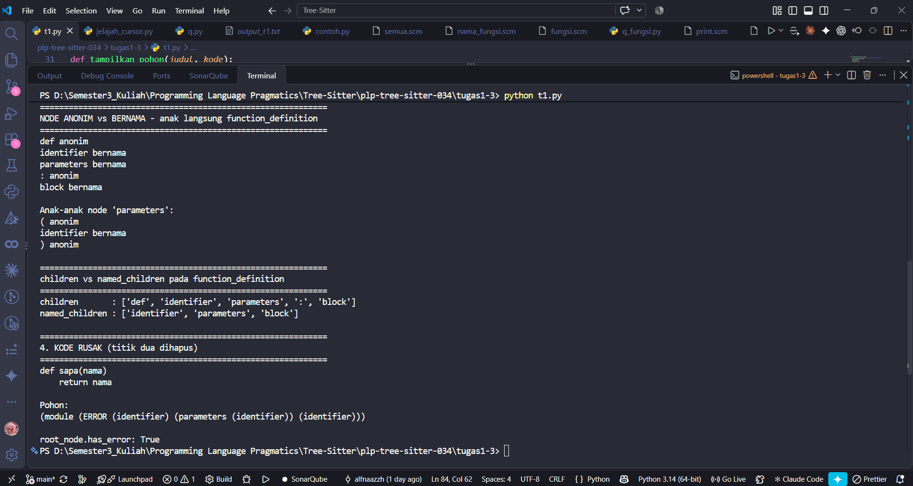
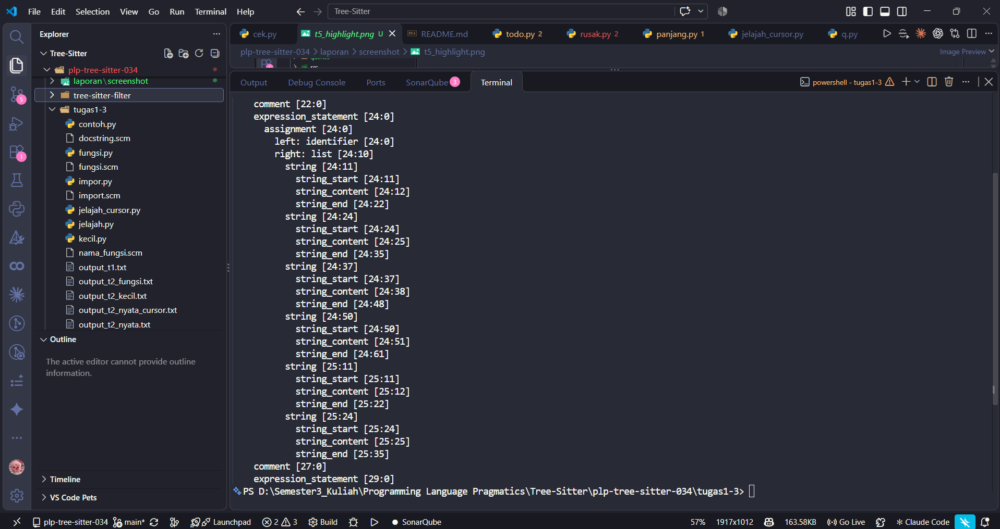
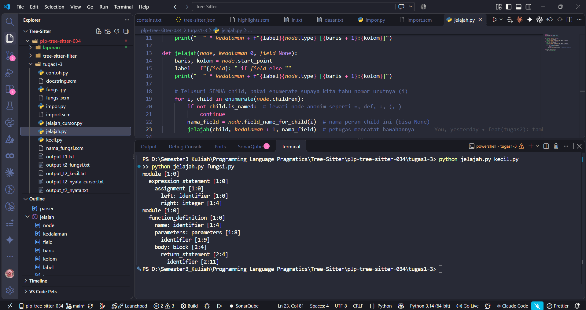
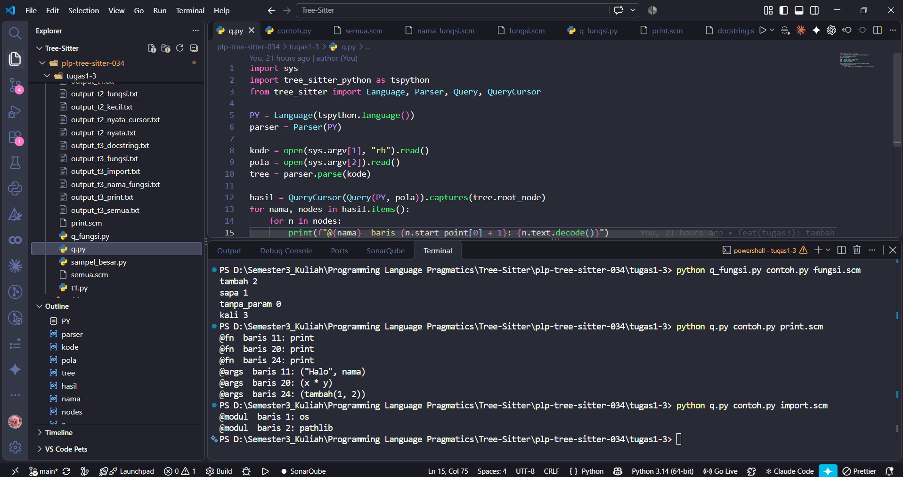
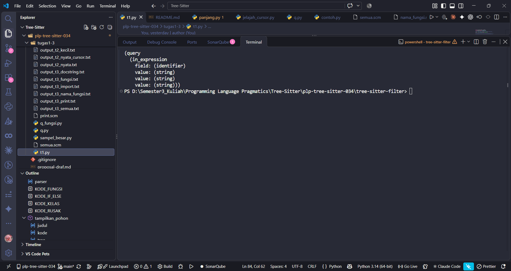
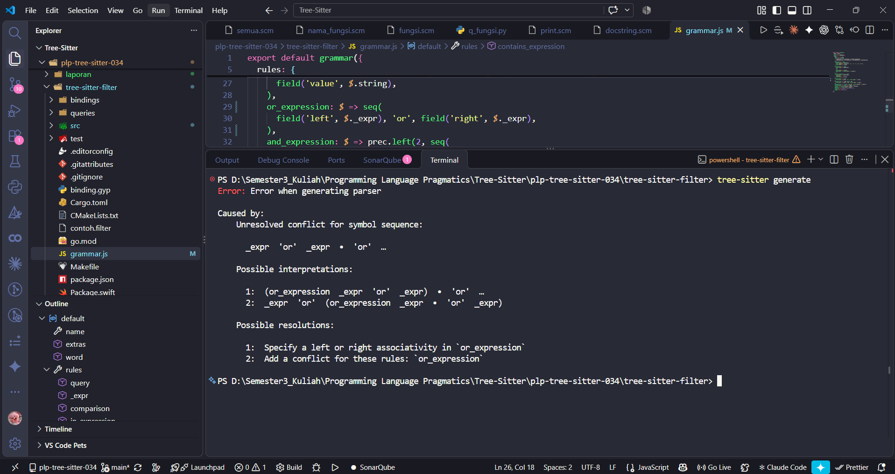
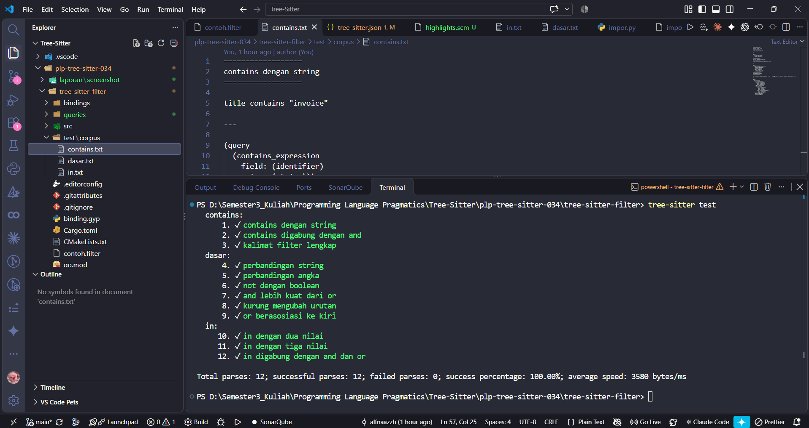
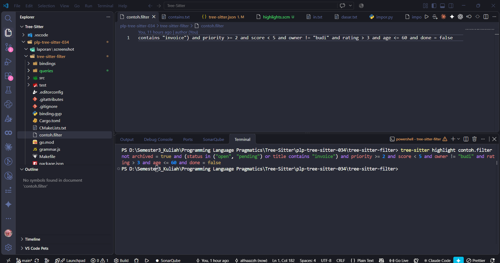
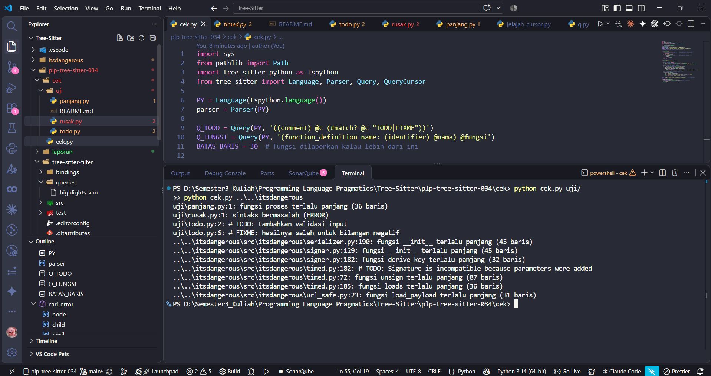

# Laporan Tugas Awal Tree-sitter (Part 1)

Nama: Alfina Azizah Anggrhaeni
NIM: 251524034
Mata kuliah: Programming Language Pragmatics
Repositori: https://github.com/alfnaazzh/plp-tree-sitter-034


## Tugas 1: Membaca pohon sintaks

Tiga potongan kode Python (fungsi `sapa`, `if`/`else` tentang `umur`, dan kelas `Mahasiswa` dengan satu method) diurai dengan `t1.py`, lalu pohonnya dibaca. Pohon yang dihasilkan adalah Concrete Syntax Tree (CST), bukan AST, karena kata kunci dan tanda baca ikut menjadi node.

| Yang diperiksa | Hasil |
| --- | --- |
| Node anonim pada `function_definition` | `def` dan `:` |
| Node anonim pada `parameters` | `(` dan `)` |
| `children` pada `function_definition` | 5 node: `def`, `identifier`, `parameters`, `:`, `block` |
| `named_children` pada `function_definition` | 3 node: `identifier`, `parameters`, `block`. Selisihnya dua node anonim |
| Node `string` | Bukan node daun: berisi `string_start`, `string_content`, `string_end` |
| Cabang `else` | Node `else_clause` dengan field `body` berisi `block` |
| `comparison_operator` (`umur >= 17`) | Berisi `identifier` dan `integer` tanpa label field |

Kode yang sengaja dirusak, yaitu titik dua pada `def sapa(nama)` dihapus, tetap menghasilkan pohon: `(module (ERROR (identifier) (parameters (identifier)) (identifier)))`. Seluruh `def` masuk ke satu node `ERROR`, sehingga tidak dikenali sebagai `function_definition`, dan `root_node.has_error` bernilai `True`. Pada kode ini node `MISSING` tidak muncul; yang muncul `ERROR`.



## Tugas 2: Penjelajah node rekursif

`jelajah.py` mencetak setiap node bernama dengan indentasi sesuai kedalaman, nama field, tipe, dan posisi `[baris:kolom]`. Fungsi `jelajah()` dimulai dari `tree.root_node` dan memanggil dirinya sendiri untuk tiap anak bernama. Nama field diambil dengan `field_name_for_child(i)` memakai indeks pada `node.children` (bukan `named_children`), karena indeks `named_children` bergeser dan membuat field salah. Node anonim dilewati dengan memeriksa `is_named`. Versi alternatif dengan `TreeCursor` tersedia di `jelajah_cursor.py`.

Pengujian dilakukan bertahap: `kecil.py` (`x = 1`), `fungsi.py`, lalu `sampel_besar.py`, salinan `colorsys.py` sepanjang 166 baris. Hasil dibandingkan dengan Playground. Playground memulai baris dan kolom dari 0, sedangkan `jelajah.py` mencetak `baris + 1`, sehingga selisih satu-satunya adalah satu baris:

| Node (`fungsi.py`) | `jelajah.py` | Playground |
| --- | --- | --- |
| `function_definition` | `[1:0]` | `[0, 0]` |
| `name: identifier` | `[1:4]` | `[0, 4]` |
| `parameters: parameters` | `[1:8]` | `[0, 8]` |
| `identifier` di dalam `parameters` (tanpa field) | `[1:9]` | `[0, 9]` |
| `body: block` | `[2:4]` | `[1, 4]` |
| `return_statement` | `[2:4]` | `[1, 4]` |
| `identifier` (`nama` pada `return`) | `[2:11]` | `[1, 11]` |

Satu potongan dari file besar juga dicocokkan: baris 24 dan 25 `sampel_besar.py` (daftar `__all__`). `right: list` berada di `[0, 10]`, dan tiap `string` memiliki tiga anak (`string_start`, `string_content`, `string_end`). Tipe, field, kedalaman, dan kolom cocok untuk semua node.




## Tugas 3: Query

Empat query dijalankan pada `contoh.py` (24 baris) lewat `q.py` dan `q_fungsi.py`: semua `identifier`, nama fungsi beserta jumlah parameter (`matches` dan `named_child_count`, supaya nama dan parameter tetap berpasangan), pemanggilan `print` (predikat `#eq?`), serta `import` dan `from ... import` (dua pola dalam satu file). Pohon `import` dilihat dulu dengan `jelajah.py` supaya nama node dan field tidak ditebak. Query tambahan `docstring.scm` memakai anchor `.` untuk baris pertama body fungsi.

Hitungan manual dilakukan dengan membaca `contoh.py` baris per baris:

| Yang dihitung | Cara menghitung | Hitungan manual | Hasil query |
| --- | --- | --- | --- |
| Fungsi dan parameter | baris 5 `tambah(a, b)`, baris 10 `sapa(nama)`, baris 14 `tanpa_param()`, baris 19 `kali(self, x, y)` | `tambah`=2, `sapa`=1, `tanpa_param`=0, `kali`=3 (4 fungsi) | `tambah 2`, `sapa 1`, `tanpa_param 0`, `kali 3` |
| Pemanggilan `print` | baris 11 `print("Halo", nama)`, baris 20 `print(x * y)`, baris 24 `print(tambah(1, 2))` | 3 pemanggilan, di baris 11, 20, 24 | tiga temuan di baris 11, 20, dan 24 |
| Import | baris 1 `import os`, baris 2 `from pathlib import Path` | modul `os` dan `pathlib` | `os` dan `pathlib` |
| Semua `identifier` | per baris: 1:1, 2:2, 5:3, 7:2, 10:2, 11:2, 14:1, 18:1, 19:4, 20:3, 21:2, 24:2 | 1+2+3+2+2+2+1+1+4+3+2+2 = 25 | 25 temuan |

Rincian `identifier`: baris 1 `os`; baris 2 `pathlib`, `Path`; baris 5 `tambah`, `a`, `b`; baris 7 `a`, `b`; baris 10 `sapa`, `nama`; baris 11 `print`, `nama`; baris 14 `tanpa_param`; baris 18 `Kalkulator`; baris 19 `kali`, `self`, `x`, `y`; baris 20 `print`, `x`, `y`; baris 21 `x`, `y`; baris 24 `print`, `tambah`. String (`"Halo"`, docstring) dan angka bukan `identifier`, jadi tidak dihitung.

Keempat hasil sesuai hitungan manual. Beberapa hal yang diamati:

- `self` ikut terhitung sebagai parameter pada `kali`, karena bagi tree-sitter `self` adalah `identifier` biasa.
- `tambah(1, 2)` di baris 24 juga berupa `call`, tetapi tidak ikut dihitung sebagai `print` karena `#eq?` mensyaratkan teks fungsinya `print`.
- Pada `from pathlib import Path`, query menangkap `pathlib` (field `module_name`), bukan `Path`.
- Query import belum menangkap `import x as y`, karena bentuknya node `aliased_import`.



## Tugas 4: Grammar DSL filter

Grammar dibangun bertahap, dari satu perbandingan (`status = "open"`) sampai mengenali enam operator perbandingan, string, angka, boolean, `and`, `or`, `not`, tanda kurung, `in (...)`, dan `contains`. Setelah tiap perubahan, parser dibangkitkan dengan `tree-sitter generate` dan pohonnya diperiksa dengan `tree-sitter parse contoh.filter`. Hasil akhir berupa 12 kasus uji di `test/corpus/` (`dasar.txt` 6 kasus, `in.txt` 3 kasus, `contains.txt` 3 kasus), semuanya lulus:

```
Total parses: 12; successful parses: 12; failed parses: 0; success percentage: 100.00%
```

Prioritas: `not` (3) lebih kuat dari `and` (2), dan `and` lebih kuat dari `or` (1). Child penting diberi `field(...)` (`field`, `value`, `left`, `right`, `operand`), dan `word` diarahkan ke `identifier`.

| Input | Hasil yang diperiksa |
| --- | --- |
| `status = "open" or priority > 2 and owner = "budi"` | Node terluar `or_expression`; anak kanannya `and_expression`, jadi dibaca `a or (b and c)` |
| `(a = 1 or b = 2) and c = 3` | Node terluar `and_expression`; di kiri, `parenthesized` membungkus `or_expression` |
| `a = 1 or b = 2 or c = 3` | `or_expression` bersarang di sisi kiri, bukti `prec.left` bekerja |
| `not archived = true` | `not_expression` dengan field `operand` berisi perbandingan bernilai `boolean` |
| `status in ("open", "pending", "closed")` | Satu `in_expression` dengan tiga `value` bertipe `string` |
| `title contains "invoice"` | `contains_expression` dengan field `field` dan `value` |
| `not archived = true and (status in ("open", "pending") or title contains "invoice") and priority >= 2` | Dua `and_expression` bersarang, memuat `not`, kurung, `in`, dan `contains` |

Pada `or_expression` tanpa `prec`, `tree-sitter generate` gagal dengan pesan `Unresolved conflict` (`_expr 'or' _expr • 'or'`). Pada `a or b or c`, parser memiliki dua kemungkinan pengelompokan: `(a or b) or c` atau `a or (b or c)`. `prec.left` menetapkan pengelompokan dari kiri, sedangkan angka prioritas yang lebih besar (`and` 2, `or` 1) membuat `and` terikat lebih kuat. Hasilnya `a = 1 or b = 2 and c = 3` terbaca sebagai `a = 1 or (b = 2 and c = 3)`. `and_expression` juga membutuhkan `prec.left`; tanpa itu `generate` gagal dengan pesan konflik yang sama.





## Tugas 5: Highlight

`queries/highlights.scm` memetakan `and or not in contains` ke `@keyword`, operator perbandingan ke `@operator`, `string` ke `@string`, `number` ke `@number`, `boolean` ke `@constant.builtin`, dan nama field ke `@property`. Pola `@property` ada tiga (di `comparison`, `in_expression`, dan `contains_expression`), karena rule `field` ada di tiga tempat itu. Entri `"highlights": "queries/highlights.scm"` ditambahkan ke `tree-sitter.json`, dan `parser-directories` diatur lewat `tree-sitter init-config`.

Pada tema bawaan CLI, `@number` dan `@constant.builtin` memiliki gaya yang sama (cokelat tebal), sehingga angka dan `true`/`false` tidak dapat dibedakan. Perbaikannya mengubah warna `number` di `config.json` CLI (di luar repositori) menjadi biru tebal (kode warna 33). Setelah itu tiap jenis token berwarna berbeda: kata kunci ungu, nama field merah, operator abu-abu, string hijau, angka biru, dan boolean cokelat.



## Tugas 6: Alat cek

`cek.py <folder>` memiliki tiga fitur: komentar `TODO`/`FIXME` (query dengan `#match?`), fungsi lebih dari 30 baris (`matches` dengan selisih `end_point` dan `start_point` ditambah 1), dan file dengan error sintaks (`root_node.has_error` dengan fungsi rekursif untuk baris pertama yang bermasalah). Folder `.git`, `venv`, `.venv`, `node_modules`, dan `__pycache__` dilewati. Pada folder `uji/` ada 4 temuan: `rusak.py` (error sintaks, baris 1), `todo.py` (`TODO` baris 2 dan `FIXME` baris 6), dan `panjang.py` (fungsi `proses`, 36 baris). Fungsi yang tepat 30 baris tidak dilaporkan, sedangkan yang 31 baris dilaporkan.

Diuji pada repositori `pallets/itsdangerous` (commit `672971d`, 15 file `.py`): 7 temuan, yaitu 1 komentar `TODO` dan 6 fungsi lebih dari 30 baris, tanpa error sintaks. Dua file dicocokkan secara manual:

| File | Hasil `cek.py` | Pengecekan manual |
| --- | --- | --- |
| `timed.py` | `TODO` baris 182; `unsign` (87 baris); `loads` (36 baris) | Satu-satunya `TODO` di baris 182. `unsign` baris 72 sampai 158 (87 baris), `loads` baris 185 sampai 220 (36 baris) |
| `url_safe.py` | `load_payload` (31 baris) | `load_payload` baris 23 sampai 53 (31 baris), tidak ada `TODO` atau `FIXME` |

Semua cocok dengan laporan `cek.py`. Hasil juga dihitung ulang dengan modul `ast` bawaan Python sebagai pembanding independen, dan keenam fungsi serta `TODO`-nya sama.



## Kendala dan cara mengatasinya

| Kendala | Cara mengatasinya |
| --- | --- |
| `tree-sitter` is not recognized | Memasang CLI dengan `npm install -g tree-sitter-cli`, lalu membuka terminal baru |
| `tree-sitter init`: `The name must be lowercase...` | Mengisi nama parser dengan `filter`, tanpa tanda hubung |
| `module is not defined in ES module scope` saat `generate` | `package.json` hasil `tree-sitter init` berisi `"type": "module"`, jadi baris pertama `grammar.js` diganti menjadi `export default grammar({` |
| `Unresolved conflict` pada `or_expression` | `prec.left` dan tingkat prioritas (Tugas 4) |
| `Error: No language found` saat `tree-sitter test` | Menjalankan dari akar `tree-sitter-filter/`, bukan dari `test/corpus` |
| Angka dan `true` berwarna sama pada highlight | Mengubah warna `number` di konfigurasi CLI (Tugas 5) |
| Fitur 2 `cek.py` tidak melaporkan fungsi panjang | `panjang.py` ternyata berisi perintah PowerShell, bukan kode Python; file dibuat ulang lewat terminal |

## Catatan penggunaan AI

Tugas dikerjakan dengan bantuan AI (Claude) sebagai pemandu langkah: AI memberi penjelasan, kode, dan perintah per langkah, sedangkan saya menjalankan semuanya di komputer sendiri, mengatasi kendala yang muncul, melakukan commit dan push, serta mencocokkan hasil dengan Playground atau hitungan manual.

| Tugas | Yang diminta | Kesalahan atau kekurangan hasil AI | Bukti |
| --- | --- | --- | --- |
| 1 | `t1.py` dan penjelasan pohon tiga potongan kode | AI memperkirakan kode rusak menghasilkan node `MISSING` (sesuai petunjuk dokumen), padahal hasilnya `ERROR` | `output_t1.txt`: `(module (ERROR (identifier) (parameters (identifier)) (identifier)))` |
| 2 | `jelajah.py` dan versi `TreeCursor` | AI menyebut baris di Playground sama dengan baris `jelajah.py` dikurangi 1. Itu salah untuk potongan yang ditempel (baris 24 menjadi baris 0 di Playground); selisih yang benar 24 | Playground menampilkan `assignment [0, 0]`, sedangkan `jelajah.py` menampilkan `[24:0]` |
| 3 | Query nama fungsi, `print`, dan `import` | Query `import` tidak menangkap `import json as j` (node `aliased_import`) | Diuji pada file tiga baris: hanya `os`, `sys`, dan `os.path` yang tertangkap |
| 4 | Grammar DSL filter bertahap | Kode grammar bergaya `module.exports` gagal pada proyek hasil `tree-sitter init` | Pesan `module is not defined in ES module scope`; berhasil setelah diganti `export default` |
| 5 | `highlights.scm` dan konfigurasi CLI | Pemetaan `@number` dan `@constant.builtin` menghasilkan warna yang sama di tema bawaan | Kode warna pada keluaran `tree-sitter highlight`; berbeda setelah warna `number` diubah |
| 6 | `cek.py`, file uji, dan README | Petunjuk membuat `panjang.py` ambigu: blok PowerShell tertempel ke dalam file, sehingga fitur 2 tidak melaporkan apa pun | `Get-Content` menampilkan `$baris = @(...)` dengan 4 baris, bukan 40 baris Python |